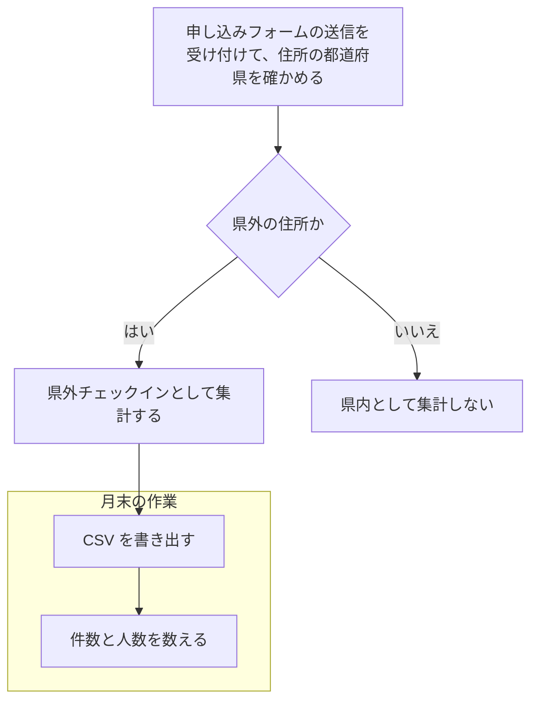
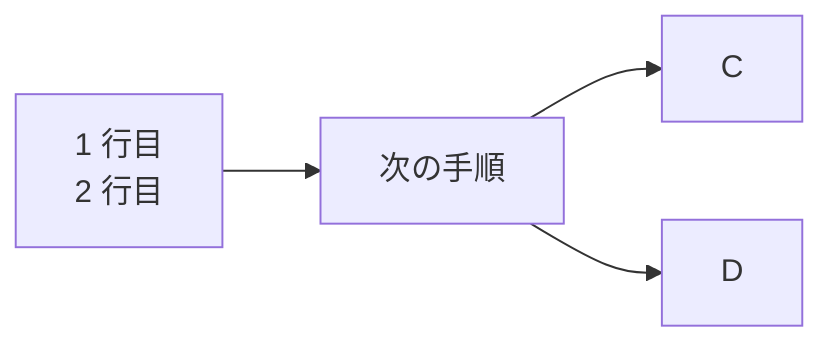
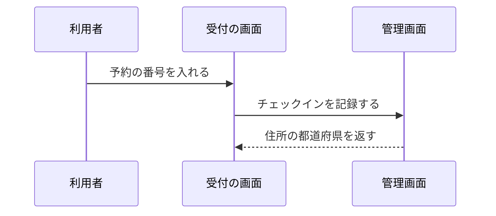
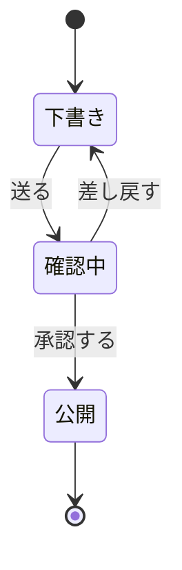
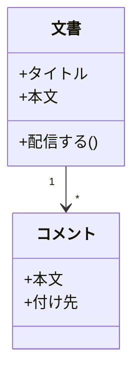
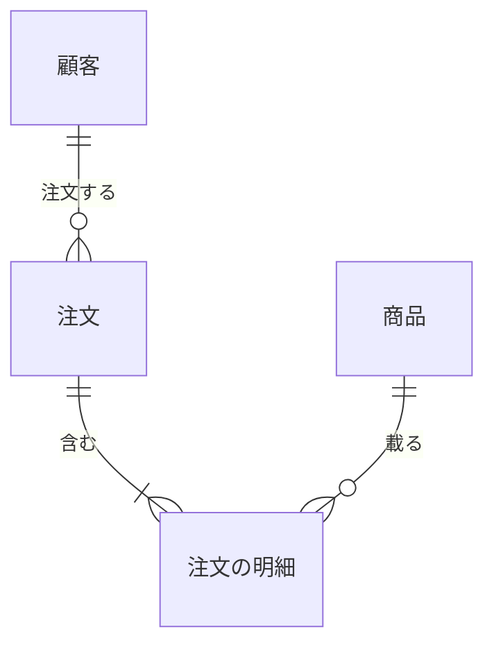
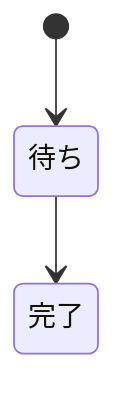
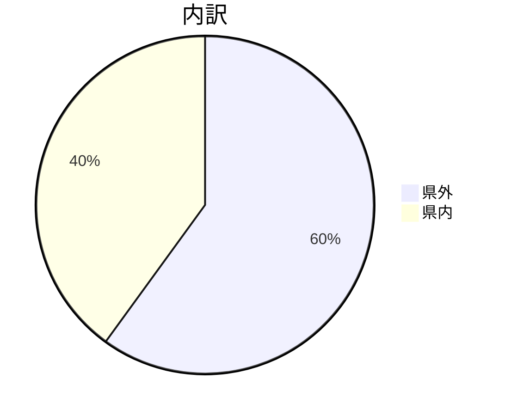
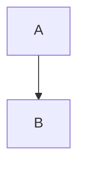

# 図の種類

## フローチャート



## graph（改行入り）



## シーケンス



## 状態



## クラス



## ER



## XY チャート

```mermaid
xychart-beta
  title "月ごとの県外の件数"
  x-axis [4月, 5月, 6月, 7月]
  y-axis "件数" 0 --> 600
  bar [120, 340, 410, 380]
  line [120, 340, 410, 380]
```

## 古い書き方の状態図



# 図にならないもの

## 対応していない種類



## 書き損じ

```mermaid
flowchart TD
  A[閉じていない --> B
```

## 空白なしの矢印



## 空

```mermaid
```

## 図にしないコード

```text
flowchart TD
  A --> B
```
